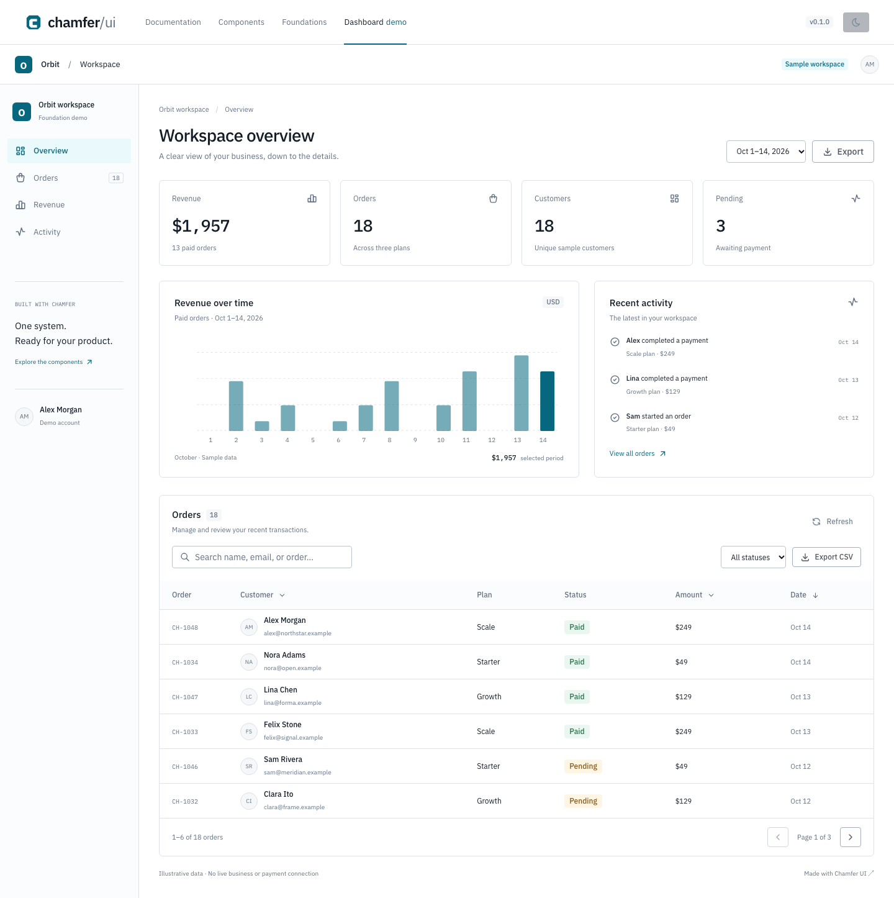

# Chamfer UI

**Precision UI for SaaS teams.** An original, compact React design foundation with shared tokens, documentation, Storybook, a working SaaS dashboard, and an editable Figma library, and a source installer.



## Run locally

Use Node.js 24 and pnpm 10.

```sh
corepack enable
pnpm install
pnpm dev
```

Open `http://localhost:3000`. The dashboard is at `/dashboard`, documentation at `/docs`, and all eight component examples at `/docs/components`.

```sh
pnpm storybook           # http://localhost:6006
pnpm tokens:build        # JSON → CSS variables + Tailwind v4 mappings
pnpm figma:build         # shared source → native Figma plugin / phase scripts
pnpm check              # tokens, types, builds, browser/a11y tests
```

## Foundation inventory

| Package / app     | Purpose                                                                                        |
| ----------------- | ---------------------------------------------------------------------------------------------- |
| `packages/tokens` | Primitive → semantic → component tokens; light/dark themes; Tailwind mappings                  |
| `packages/ui`     | Button, TextField, Badge, Card, Separator, Skeleton, semantic Table parts, responsive AppShell |
| `apps/docs`       | Next.js site, component previews and API guidance, foundations, dashboard                      |
| `apps/storybook`  | All component specimens, theme toolbar, controls, docs, accessibility addon                    |
| `packages/cli`    | Original source-copy installer with bundled registry, conflict protection, and backups         |
| `scripts/figma`   | Native Figma generation from shared values and sample records                                  |

The workspace packages are private in this milestone. They are consumed through `workspace:*`, not a published npm package. The UI package builds JavaScript and declarations into `packages/ui/dist`; documentation and Storybook transpile the shared source directly.

## Use a component

```tsx
import { Button, TextField } from '@chamfer/ui';
import '@chamfer/ui/styles.css';

<Button variant="primary" size="md" onClick={save}>Save changes</Button>
<TextField label="Project name" description="Choose a clear name." />
```

Add the UI and token packages to a workspace consumer's dependencies. Tailwind v4 consumers import `@chamfer/tokens/tailwind` to use semantic utilities such as `bg-surface`, `text-foreground`, and `border-border`. Standard attributes and refs are forwarded. Table behavior belongs to the application; the core exports semantic table parts.

Set `data-theme="light"` or `data-theme="dark"` on the document or a local theme boundary. The site honors a saved theme, then system preference. Self-hosted IBM Plex fonts are bundled through Fontsource.

## Dashboard behavior

All records are synthetic. Search customer names, emails, order IDs, or plans. Filter payment status, sort customer/amount/date, paginate, narrow the date range, simulate loading with Refresh, and download the filtered records as CSV. The dashboard has no live payments, auth, or backend connection.

Mobile navigation is an inline disclosure. Escape closes it and returns focus. Wide tables scroll within their own region rather than overflowing the page.

## Install into your own React app

```sh
# From this repository
pnpm installer:pack

# From your React 19 / Tailwind CSS 4 project
pnpm add -D /absolute/path/to/DS1/artifacts/chamfer-cli-0.1.0.tgz
pnpm exec chamfer init --css src/index.css
pnpm exec chamfer add button text-field
```

Components are copied into your application as editable source. `chamfer add app-shell` resolves its Button dependency. `--dry-run` previews changes; `--force` backs up customized requested components before replacement. See [the installer guide](packages/cli/README.md). This is a local alpha, not a published npm package.

## Figma

The [Eftax foundation file](https://www.figma.com/design/H2vHC7eByauNSQL06qtO3o/Untitled?node-id=3-110) contains native foundations, light/dark variables, component variants, and desktop/mobile dashboard layouts. Source generation remains available for reproducible imports. See [the Figma guide](assets/figma/README.md) for node links, validation evidence, and visual comparison limits.

## Verification

`pnpm installer:smoke` packs the CLI, installs it in an independent React application outside the workspace, copies all eight components, type-checks and builds the app, and checks rendering, fonts, themes, accessibility, and mobile keyboard behavior.

`pnpm check` builds the UI, Next.js site, and Storybook, then runs Playwright behavior and axe accessibility tests. Tests cover the dashboard flow, loading/empty states, theme persistence, mobile focus, field errors, every primary documentation surface, and every Storybook specimen. Both themes are scanned on the main site.

Chromium and WebKit pass locally. Firefox's downloaded binary fails to launch on this macOS host with `Could not find profile folder`, before any app code runs. macOS defaults to the two working engines; Linux CI includes Firefox. Try it explicitly with `CHAMFER_TEST_FIREFOX=1 pnpm test`.

```sh
pnpm exec playwright install chromium webkit
pnpm build
pnpm storybook:build
pnpm test
pnpm previews            # captures the running localhost:3000 site
```

Automated accessibility checks complement manual keyboard and screen-reader review; they do not certify conformance. Preview evidence is in `assets/previews/`.

## License and boundaries

Core code and the foundation assets in this repository use the [MIT license](LICENSE). Future Chamfer Pro assets will have a separate license and remain outside the public core repository. The larger library, paid templates, pricing, commerce, customer accounts, and public publication are later milestones.

See [CONTRIBUTING.md](CONTRIBUTING.md), [CHANGELOG.md](CHANGELOG.md), and [PRODUCT.md](PRODUCT.md).
