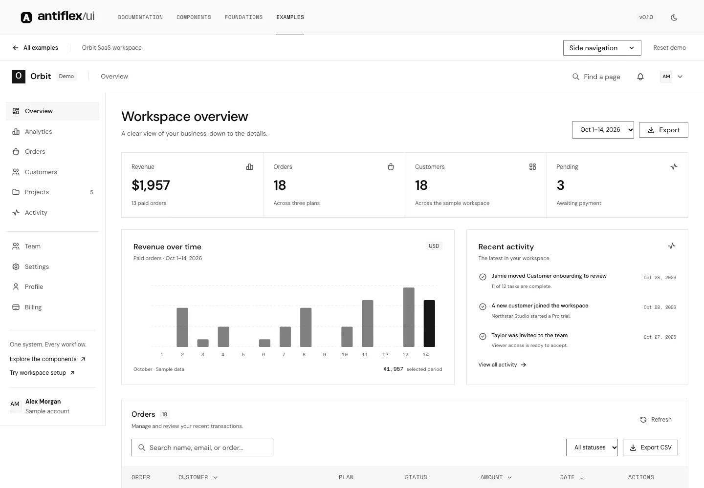

# antiflex/ui

**less flex. More function.** A design system that favors familiar patterns, thoughtful defaults, and intuitive experiences over unnecessary complexity. Shared tokens, React components, documentation, Storybook, Figma foundations, and connected SaaS demos.



## Explore the product examples

Open [the examples gallery](https://antiflex-ui.vercel.app/examples) or [the connected Orbit workspace](https://antiflex-ui.vercel.app/demo). Thirteen interactive SaaS screens cover overview, analytics, orders, customers, projects, activity, team, settings, profile, billing, demo checkout, sign-in and onboarding. Switch between sidebar and top navigation, in light or dark mode.

All data and prices are illustrative; checkout and authentication are local previews. See [docs/EXAMPLES.md](docs/EXAMPLES.md) for the route inventory, working flows, storage model, and verification commands.

## Hosted alpha

- [Documentation and dashboard](https://antiflex-ui.vercel.app)
- [Storybook](https://antiflex-storybook.vercel.app)

Explore the [public source repository](https://github.com/insannurjaman/antiflex-ui) and [download the installer](https://antiflex-ui.vercel.app/downloads/antiflex-ui-0.1.0-alpha.2.tgz). See [the release guide](docs/RELEASE.md).

## Run locally

Use Node.js 24. Open the **DS1 repository folder** in VS Code, then start the site from its terminal:

```sh
npm run dev
```

Dependencies are already installed in this working copy. For a fresh checkout, install the pnpm workspace dependencies first:

```sh
npx --yes pnpm@10.34.3 install --frozen-lockfile
npm run dev
```

Open `http://localhost:3000`. The dashboard is at `/dashboard`, documentation at `/docs`, and all 50 component examples at `/docs/components`.

In VS Code, **Terminal → Run Task → antiflex: dev** runs the same command from the repository root. Press `Ctrl+C` in its terminal to stop the server. `pnpm dev` also remains supported when pnpm is installed.

Use pnpm for dependency installation: this repository uses `workspace:*` packages, so `npm install` is not the workspace setup command. If port 3000 is occupied, stop the previous server or run `npm run dev -- --port 3002` and open the URL printed in the terminal.

```sh
pnpm storybook           # http://localhost:6006
pnpm tokens:build        # JSON → CSS variables + Tailwind v4 mappings
pnpm figma:build         # shared source → native Figma plugin / phase scripts
pnpm figma:forms         # form foundation reconciliation scripts for the source Figma file
pnpm figma:feedback      # feedback/navigation reconciliation scripts for the same file
pnpm figma:modals        # Dialog/Alert Dialog variants and themed modal specimens
pnpm check              # tokens, types, builds, browser/a11y tests
```

## Foundation inventory

The current source has 50 component families: eight foundation, ten form, fifteen feedback/navigation, two modal families, two floating families, two edge-panel families, two action-menu families, Toast, Hover Card, Menubar, Navigation Menu, Select, Combobox, Command, Calendar, and Date Picker. The catalog continues to expand; see the [component roadmap](docs/COMPONENT-ROADMAP.md) and [source-based comparison with shadcn/ui](design/research/shadcn-component-audit.md). Planned components are not included in the inventory. The current installer alpha includes all 50 families and can also be packed locally.

| Package / app     | Purpose                                                                                 |
| ----------------- | --------------------------------------------------------------------------------------- |
| `packages/tokens` | Primitive → semantic → component tokens; light/dark themes; Tailwind mappings           |
| `packages/ui`     | 50 original component families: foundation, forms, feedback, navigation, and disclosure |
| `apps/docs`       | Next.js site, component previews and API guidance, foundations, dashboard               |
| `apps/storybook`  | All component specimens, theme toolbar, controls, docs, accessibility addon             |
| `packages/cli`    | Original source-copy installer with bundled registry, conflict protection, and backups  |
| `scripts/figma`   | Native Figma generation from shared values and sample records                           |

The UI and token packages remain private workspace internals. The source installer is published on npm as `antiflex-ui@0.1.0-alpha.2`, with an official versioned download. They are consumed through `workspace:*`, not a published npm package. The UI package builds JavaScript and declarations into `packages/ui/dist`; documentation and Storybook transpile the shared source directly.

The form composition example is available locally at `/docs/forms`. New families: Input, Label, Field, Textarea, NativeSelect, Checkbox, RadioGroup, Switch, ButtonGroup, and InputGroup. TextField retains its existing public API.

The feedback/navigation example is at `/docs/feedback`: Alert, Avatar, Breadcrumb, Empty, Kbd, Pagination, Progress, Spinner, Tabs, Accordion, Collapsible, Toggle, ToggleGroup, Typography, and AspectRatio. Matching Figma review boards contain 99 variants across these fifteen families.

The focused-task example is at `/docs/modals`. Dialog and AlertDialog share a native modal foundation with controlled state, nested focus, Escape, scroll locking, and explicit focus-return targets. The anchored assistance example at `/docs/floating` adds Popover and Tooltip with shared positioning, controlled state, and nested Escape handling. Together the two batches add 24 Figma variants. Storybook now contains 304 specimens across the complete catalog. Toast adds a local save/archive/undo example at `/docs/notifications`, bounded notifications, async recovery actions, and deliberate timing without taking focus.

## Use a component

```tsx
import { Button, TextField } from '@antiflex/ui';
import '@antiflex/ui/styles.css';

<Button variant="primary" size="md" onClick={save}>Save changes</Button>
<TextField label="Project name" description="Choose a clear name." />
```

Add the UI and token packages to a workspace consumer's dependencies. Tailwind v4 consumers import `@antiflex/tokens/tailwind` to use semantic utilities such as `bg-surface`, `text-foreground`, and `border-border`. Standard attributes and refs are forwarded. Table behavior belongs to the application; the core exports semantic table parts.

Set `data-theme="light"` or `data-theme="dark"` on the document or a local theme boundary. The site honors a saved theme, then system preference. Self-hosted DM Sans, Space Mono, and Anybody fonts are bundled through Fontsource.

## Dashboard behavior

All records are synthetic. Search customer names, emails, order IDs, or plans. Filter payment status, sort customer/amount/date, paginate, narrow the date range, simulate loading with Refresh, and download the filtered records as CSV. The dashboard has no live payments, auth, or backend connection.

Mobile navigation is an inline disclosure. Escape closes it and returns focus. Wide tables scroll within their own region rather than overflowing the page.

## Install into your own React app

```sh
# From your React 19 / Tailwind CSS 4 project
npx antiflex-ui@0.1.0-alpha.2 init --css src/index.css
npx antiflex-ui@0.1.0-alpha.2 add button text-field
```

You can also build and use a local tarball:

```sh
# From this repository
pnpm installer:pack

# From your React 19 / Tailwind CSS 4 project
pnpm add -D /absolute/path/to/DS1/artifacts/antiflex-ui-0.1.0-alpha.2.tgz
pnpm exec antiflex init --css src/index.css
pnpm exec antiflex add button text-field
```

Components are copied into your application as editable source. `antiflex add app-shell` resolves its Button and Spinner dependencies in this workspace. `--dry-run` previews changes; `--force` backs up customized requested components before replacement. See [the installer guide](packages/cli/README.md). The first npm release is an alpha; component APIs may change before 1.0.

## Figma

The [Eftax foundation file](https://www.figma.com/design/H2vHC7eByauNSQL06qtO3o/Untitled?node-id=3-110) contains native foundations, light/dark variables, component variants, and desktop/mobile dashboard layouts. Source generation remains available for reproducible imports. See [the Figma guide](assets/figma/README.md) for node links, validation evidence, and visual comparison limits.

## Verification

`pnpm installer:smoke` packs the CLI, installs it in an independent React application outside the workspace, copies all current components, type-checks and builds the app, and checks rendering, fonts, themes, accessibility, and mobile keyboard behavior.

`pnpm check` builds the UI, Next.js site, and Storybook, then runs Playwright behavior and axe accessibility tests. Tests cover the dashboard flow, loading/empty states, theme persistence, mobile focus, field errors, every primary documentation surface, and every Storybook specimen. Both themes are scanned on the main site.

Chromium and WebKit pass locally. Firefox's downloaded binary fails to launch on this macOS host with `Could not find profile folder`, before any app code runs. macOS defaults to the two working engines; Linux CI includes Firefox. Try it explicitly with `ANTIFLEX_TEST_FIREFOX=1 pnpm test`.

```sh
pnpm exec playwright install chromium webkit
pnpm build
pnpm storybook:build
pnpm test
pnpm previews            # captures the running localhost:3000 site
```

Automated accessibility checks complement manual keyboard and screen-reader review; they do not certify conformance. Preview evidence is in `assets/previews/`.

## License and boundaries

Core code and the foundation assets in this repository use the [MIT license](LICENSE). Future antiflex Pro assets will have a separate license and remain outside the public core repository. The larger library, paid templates, pricing, commerce, and customer accounts are later milestones.

See [CONTRIBUTING.md](CONTRIBUTING.md), [CHANGELOG.md](CHANGELOG.md), and [PRODUCT.md](PRODUCT.md).

The edge-task example at `/docs/panels` adds Sheet (four physical edges) and Drawer (content-sized bottom tasks). Both reuse the native modal foundation and keep actions visible while Body scrolls. Drawer does not include swipe or snap points. This batch adds 22 stories and 34 Figma variants, with nine shared size tokens.

The expanded foundation adds `/docs/foundations/colors` (26 reference palettes × 11 shades, search and copy) and `/docs/foundations/typography` (13 sizes, nine weights, leading/tracking, and a live playground). Existing antiflex theme aliases and legacy component sizing remain stable. Reference data is pinned to Tailwind CSS 4.3.3 under MIT; OKLCH stays canonical, with clipped sRGB previews in HEX/Figma. Raw reference utilities use `af-`, such as `bg-af-blue-500` and `text-af-xl`.

The action-menu example at `/docs/menus` adds Dropdown Menu and Context Menu. Both include nested commands, checkbox/radio preferences, typeahead, RTL keyboard navigation, and native top-layer collision handling. Context Menu supports right-click and Shift+F10; the visible dropdown provides equivalent touch actions. Shortcut hints are visual only. No custom long-press or hover-open submenu behavior is included.

The workspace navigation and planning example is at `/docs/workspace-tools`. Eight original families add command/navigation entry, previews, native form selection, local action search and single-date planning. Calendar and Date Picker use Gregorian date-only values; range selection, virtualization and global shortcuts are outside this milestone.
